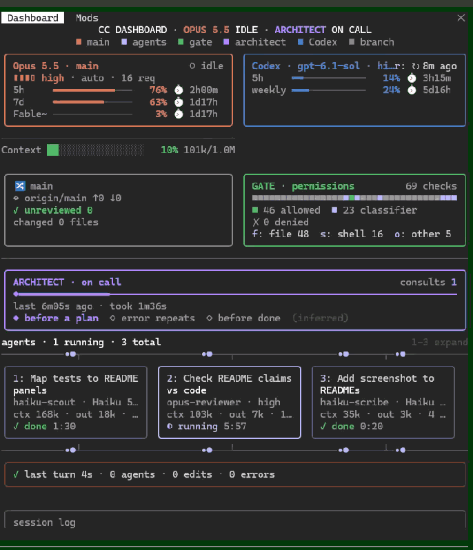

# cc-dashboard

**English** · [繁體中文](README.zh-TW.md)

A Claude Code mod that draws a live mission-control pane beside the transcript (or above the prompt). It shows only real session events and readings: no made-up numbers.



Built on [Flightdeck](https://github.com/scasella/claude-flightdeck) (Stephen Casella, MIT). The layouts, panels, interactions and English labels come from Flightdeck. cc-dashboard adds:

- A **Codex usage** panel: 5-hour and weekly usage. It normally reads local files only; the server is asked for fresh figures only when you press `↻`.
- A **branch** panel: branch, sync state, and **how many files are unreviewed and how many changed**.
- **Fable weekly usage** in the main box.
- A red **"waiting on you"** line when another Claude Code session needs you (this session also writes its own wait mark).
- **`codex exec` runs shown as subagent cards** (no Codex session id).
- An **orange flow line** under the main box: it runs while the main session works, matching the subagents' line.
- Paired layout, a context line of its own, and a dock width that follows the terminal.

## Panels

| Panel | Shows | From |
| :- | :- | :- |
| **Waiting on you** (red line under the header) | Only when *another* running Claude Code session is waiting on you: `! waiting on you: <session name> <permission/question> <time, e.g. 3m ago>`, with ` · +<n> more` when several (longest wait first). Absent, and taking no row, when nobody waits | See "Waiting on you" below |
| **Main** | Model, effort, permission mode, request count. Claude's first two usage windows (`5h`, `7d`) and **Fable weekly usage** get a row each: a stretched `━─` bar, percent used, and the time to reset (⏱). Past its reset a window counts as restarted and reads `~0%` and `stale` until a new reading arrives; a failed Fable refresh labels it `Fable~`. Bars in one box share a width and line up. Right under the box is an **orange flow line** as wide as the box: packets run while the main loop works, a still dim line otherwise; two boxes to a row put it under the main box's side only; `motion: off` keeps it still. The `Context` meter (`█░` bar, percent used, `116k/200k`, compactions ⟲) is not in the box: it is a frameless line of its own under the main box (or the pair) and the orange line, about half the column wide and left-aligned (the left column in the wide layout, the whole pane otherwise), with a blank row below it. The filled bar and the percent share one colour: green under 50%, yellow from 50%, red from 80% (following the chosen palette); the track is faint. Not drawn when `panels` has no `main`, nor while no context reading exists | `turn.step`, `session.measure`, `session.compact`, `$.session.usage()`; Fable below |
| **Codex** | `Codex · <model> · <effort>`, then `5h` and `weekly` windows, a row each: a percent-used bar and the time to reset. A window past its reset counts as restarted (Codex only opens a new window at its first request after the reset) and reads `~0%` with `stale` until a new reading arrives. When no figures can be read, the reason shows (e.g. `no usage recorded yet`). The `↻` button at the right of the title (hotkey `r`) asks the server for fresh figures only when pressed, and says how long ago it last did (`↻ 3m ago`) | See "Codex usage" below |
| **Branch** | `🔀 <branch>`, `↔ <upstream> ↑ahead ↓behind` (`no upstream` without one), and **`unreviewed N files · changed M files`**. All reviewed reads `✓ unreviewed 0`; when it cannot be known it reads `unreviewed ?`, never 0. With unreviewed files, `u` unfolds the list (up to 8 rows, the rest counted as `… N more`) | See "Branch" below |
| **Architect** | A timeline of consults, whether one is running, how long the last took; the inferred moment of each (`before a plan` / `error repeats` / `before done`, marked `(inferred)`); the first line of a subagent architect's advice | An agent type that matches the pattern, or a matching server tool in the assistant's rows |
| **Gate** | One cell per permission check: green allowed by a rule, blue decided by the classifier or by you and then run, amber pending, red ✗ denied; checks made inside a subagent are dimmer. Totals, and a drill-down per tool family (`f` file / `s` shell / `o` other) of the last 5 checks, credentials masked | `tool.check`, settled by the `tool.call` around it |
| **Agents** | Cards side by side while they fit: task, type, model (left out when it matches the main loop's) and effort (`high`; a numeric effort as the number; none, none shown), ctx and output tokens, steps, a running clock, `max_tokens` in red. Beyond that, swimlanes on one time axis. `1`–`6` expand: the full task, model and effort, the last 3 tool calls, the start of the answer. **A `codex exec` is a card too**: type `Codex`, the model and effort the Codex panel read from its config, the task its purpose (`Codex plan draft` / `Codex review` / `Codex resume` / `Codex`, with the call's description), counted as running; no Codex session id is shown | `agent.spawn`, `turn.step`, `tool.call`, `turn.complete`; Codex below |
| **Other loops** | Model loops that match no card: workflow agents, compactions, memory forks | `turn.step` ids no card claims |
| **Receipt** | The running turn, or the last one: duration, agents, edits, errors | `turn.start`, `turn.complete` |
| **Log** | Prompts, spawns, completions, consults, edits, errors and denials; filtered to one agent while you view its transcript | All of the above |

A panel with nothing to show takes no room: no subagents, no agents panel; outside a git repository, no branch panel; no readable Codex, no Codex panel.

**Layouts.**
- *Wide* (docked, 110 columns or more): the left column holds main, Codex, architect and gate; the right column holds branch, agents, other loops and receipt; the log runs full width at the bottom.
- *Single column with the layout on `auto`* (a pane under 110 columns): from 70 columns (about a 180-column terminal at a 40% dock) two pairs share a row: main | Codex, then branch | gate (the gate moves above the architect). After them come architect, agents, other loops, receipt, log. The two boxes of a pair are the same height; the shorter one stretches. If one of the two has nothing to show, or `panels` leaves them apart, the other fills its row as before. `compact` never pairs, and below 70 columns the stacked layout is unchanged. Inside a pair the wording narrows: the main box's effort, mode and request count fold into `▮▮▮▯ high · auto · 12 req`; the Codex box drops `quota · used`; the branch box puts the sync state and each count on a row of their own; the gate's summary and buttons wrap, so `✗ N denied` is never cut.
- *Inline above the prompt* (not fullscreen): a summary of at most 8 rows. The first row is the model, the context and Claude's `5h 2% · 7d 3%` (from the API response, available after the session's first reply); the red line is on the second; Fable, Codex and the branch share one row: `Fable 31%   Codex 5h 13% · weekly 40%   🔀 main unreviewed 2 files · changed 5 files`. While those rows show, fewer agent rows are listed so the total stays within 8.

## Dock (fullscreen)

After `/tui fullscreen` (or `"tui": "fullscreen"` in `settings.json`, effective at the next start) the pane docks beside the transcript at `dockPercent`% of the terminal's width (default 40%, less the frame, at least 40 columns) and follows the terminal within about 2 seconds of a resize, but only while the terminal is at least 144 columns wide (narrower, it keeps its width). The terminal's width is known only from a drawing of the terminal's own pane or from running `/dashboard`, so at first the dock keeps the engine's default width and takes its share after the first drawing; a Desktop or phone attached to the session does not affect it. A width you dragged the dock to wins (an engine rule). The fullscreen layout docks from 110 columns; opening on start (when nobody asked) needs 144, and below that `/dashboard` opens it. `/dashboard` asks to bring the pane to the front and focus it (the engine grants that while the prompt has the keys and the composer is empty; `Esc` returns to the prompt).

## Use

```
claude --plugin-dir N:\projects\github\cc-dashboard
```

| Command | Does |
| :- | :- |
| `/dashboard` | open the pane |
| `/dashboard close` | close it |
| `/dashboard reset` | clear agents, checks, consults, log and the turn (usage, compactions, Codex and branch stay) |
| `/dashboard refresh` | ask the server for Codex usage (same as `↻`), and read the branch and the other sessions' waits again now (whether or not the pane shows; Fable keeps its own schedule) |
| `/dashboard layout auto\|compact\|wide\|mini` | override the layout for this session |

With the pane focused (`ctrl+x tab`, or `/dashboard`): `1`–`6` expand an agent card or lane, `f` `s` `o` open the gate's drill-down, `u` unfolds the unreviewed files, `r` asks the server for Codex usage. `/clear` resets the pane along with the conversation (Codex and branch are untouched).

## Codex usage

Read-only, display-only. It needs `USERPROFILE` and `SystemRoot` (Windows); without either nothing is read and the Codex panel does not appear.

- **Model and effort:** the model is the `codex` key of `~/.claude/model-choice.json` (the rules' default, `gpt-6-sol`, without one); the effort is the first line of `~/.codex/config.toml` that begins `model_reasoning_effort = "…"` (double quotes, unindented; wherever it sits in the file, so possibly inside a profile; a single-quoted value gives none).
- **Windows, the server only when you press `↻`:** pressing `↻` on the Codex box's title (hotkey `r` with the pane focused, or `/dashboard refresh`), if `~/.codex/auth.json` holds a ChatGPT login (`tokens.access_token`; `tokens.account_id` is sent as `ChatGPT-Account-Id` only when it is present and valid), sends `GET https://chatgpt.com/backend-api/wham/usage`. That is the call Codex's own `/status` makes, with the headers Codex sends (`Authorization: Bearer …`, `ChatGPT-Account-Id`, `User-Agent: codex-cli`). It answers the account's server-side 5-hour and weekly percent used and reset times and **spends none of the quota**; usage from another computer or Codex on the web counts, so the figures are current even if Codex was not called. The token is used for that one request only: never kept in state, never drawn, never written back to `auth.json` (when it has expired it waits for Codex's next run to refresh it, and until then the call is refused and the rollouts are read instead). Only the characters a JWT or an id holds are accepted, so nothing extra can be smuggled into a header. This is an **undocumented private API**: an answer of another shape, a refusal, no network, or an API-key login (no ChatGPT token) all fall back to the rollouts below. A press (or `/dashboard refresh`) while a Codex read is already under way is ignored.
- **Windows, the rollouts normally** (the schedule reads local files only and sends no request; also used when you press `↻` and the server does not answer): from the newest 14 day folders of `~/.codex/sessions/YYYY/MM/DD` (no older folder once 200 files are listed; a folder that cannot be listed counts as empty), each candidate is ranked by its own last-modified time (asked of the file system one by one, not the listing's time, which can be stale; where that fails the listing's time stands). The 2 most recently modified rollouts are read (a long-lived older session keeps writing to its original file; the next 2, up to 4 in all, only when neither holds a codex reading), and the reading whose event `timestamp` is latest wins (a tie goes to the more recently modified; a reading with no parseable time counts as oldest). One command per rollout (usually 2 per refresh, at most 4), through `%SystemRoot%\System32\WindowsPowerShell\v1.0\powershell.exe` (a full path, not PATH), takes the lines containing `"limit_id":"codex"` from the last 2000 lines of the file and keeps the last 5 of them. The rollout's path rides in the environment variable `ROLLOUT`, never in the command text. The 5-hour and weekly windows are told apart by their length.
- **The newer reading is shown.** A server reading is dated by the ask, a rollout by its event time (a reading with no time counts as oldest), so after `↻` an older rollout does not overwrite it, and once you use Codex here the newer rollout takes over. The `↻` button says how long ago the server last answered (`↻ 3m ago`). A new reading that lacks a window keeps the old one. The rollouts are read every 5 minutes, only while the pane shows.

## Fable weekly usage

`GET https://api.anthropic.com/api/oauth/usage`, authorised by the engine's own handle (the credential never reaches this plugin; only a bearer login can use the endpoint, and without one nothing is asked or shown). It takes the `limits[]` entry whose `kind` is `weekly_scoped` and whose model name contains Fable. Every 90 seconds; after a failure the wait doubles up to 10 minutes (a longer `retry-after` is followed too, but never past 10 minutes, and only in seconds, not as a date), and the last figure stays with the label `Fable~`. Once the window's reset time has passed it reads `~0%`.

## Waiting on you

- **Reading (other sessions):** the local session registry `~/.claude/sessions/<pid>.json` (only the newest 32 plain files with numeric names, 64 KB or smaller), plus the process table, `%SystemRoot%\System32\tasklist.exe /FO CSV /NH` (a full path, 15-second timeout); only sessions whose pid still runs as `claude` or `node` count. Then their mark files, `~/.claude/mods-state/status-sidebar/waiting/<pid>.json`, whose `sessionId` must equal the registry's (a stale file from a reused pid does not count). Marks are read about every 5 seconds, the registry and `tasklist` about every 30. Whenever a step cannot be read, nothing is shown: nothing is guessed.
- **Writing (this session's own):** the same folder and the same format as status-sidebar, `{"sessionId":…,"reason":"permission"|"question"|null,"sinceMs":…}`, so sessions running either mod see each other. `classic.PermissionRequest` writes `permission`; `AskUserQuestion` / `ExitPlanMode` write `question` when they start. It clears when that call returns, when you type a new prompt, when the main turn ends, and when the session ends. Driven by events, so it is written whether or not the pane shows.
- A permission wait is known to start and not to end until its call returns, hence "may be waiting on you". The session name is cut to 80 characters, and control, format, separator and tag characters in it become spaces, before it is drawn.

## Codex runs (as subagents)

`codex exec` / `codex exec resume` that the main conversation runs through Bash or PowerShell (a subagent's calls do not count). It counts only in command position: a `codex exec` inside quotes, a comment, a heredoc body or a PowerShell here-string is not a run (masking and matching are a single pass over the first 64 KB). The purpose comes from the command: `resume` is `Codex resume`, `--sandbox read-only` is `Codex plan draft`, `workspace-write` is `Codex review`, anything else is `Codex`; the card's model is the one the Codex panel read.

- A foreground run ends when its call returns; an `isError` or a refusal is a failure.
- A run moved to the background (the result carries `backgroundTaskId`) stays running until its `task-notification` ends it (`task-id`, `tool-use-id` and `status` are read from before `<summary>`; a `failed` / `killed` / `error` status, or a non-zero `(exit code N)` in the `<summary>` text, is a failure). A notification never makes this mod open a file.
- At each turn's `classic.Stop` it is checked against the engine's own list: a foreground run still open is inferred failed, a background run the list no longer holds is inferred done.

## Branch

Read-only `git`, through `$.process.run` (15-second timeout). Every call carries `--no-optional-locks -c core.quotePath=false -c core.fsmonitor=false -c protocol.ext.allow=never` and the environment variable `GIT_NO_LAZY_FETCH=1`: `rev-parse --show-toplevel`; `config` (lists the filter drivers, then switches every one off for `status` and `hash-object`; a partial clone is not read at all; if they cannot be listed nothing further is read); `status --ignore-submodules=all --porcelain=v2 --branch -z -uall`; and `hash-object --no-filters --stdin-paths` (no `-w`, so no object is written). A symbolic link, or a path that lands outside the repository, is not hashed and always counts as unreviewed. Output the engine cut short is a failure. Every 30 seconds, and once right after a main turn ends.

- **Changed** = files that differ from HEAD (untracked included).
- **Unreviewed** = changed files whose content differs from what the last review saw.
- **The review record** (one of the plugin's two writes; the other is the wait mark under "Waiting on you"): its own `$.store`, key `git-reviewed:<repository root>`, value "path → content hash"; a second key, `git-reviewed-index`, keeps the order of the 8 most recently written repositories, the only ones kept, 2000 paths each (past that it stores `too-many-paths` and the panel reads `unreviewed ?`; with more than 500 untracked files no hashes are made, so the panel reads `unreviewed ?` and no record is written). It is written only when: (1) a `Skill` call whose skill name contains `review`; (2) an `Agent` call whose `subagent_type` contains `review` (for both, the tree is read as the call begins and kept only if the call is not refused and does not fail); (3) a `/…review` slash command that you type yourself (`composer` / `bridge` / `sdk` origin), the tree read and recorded as it is sent.

Fable, Codex, git and the other sessions' waits are polled only while the pane shows (a pump looks every 2 seconds at which is due). A closed pane, or one in a background tab, makes no scheduled request and runs no scheduled process. These run whatever the pane's state: to learn the file name of its own mark, the session reads the registry and `tasklist` once at start (or when a mark is to be written and the pid is not known yet); a review trigger (the `Skill` / `Agent` call or the typed `/…review` above) reads the git tree; `/dashboard refresh` asks and reads now; and the wait mark is written on events (see "Waiting on you").

## Inferred, not measured

- The architect's moments: `before a plan` = no edit yet this turn, `error repeats` = 2 or more main-loop errors in a row, `before done` = edits were made. Marked `(inferred)`; `moments: false` turns them off.
- A server-side architect (such as `advisor`) is encrypted: it can be counted and timed, not read.
- An agent's ctx is its latest request's whole input, not a cost.

## Configure

In `/config`, or under `pluginConfigs["cc-dashboard"].options` in `settings.json`:

| Option | Default | Meaning |
| :- | :- | :- |
| `architectPattern` | `advisor\|architect` | case-insensitive regex for agent types and server tools that count as the architect |
| `matchDescriptions` | `false` | also match agent descriptions |
| `architectLabel` | `ARCHITECT` | the architect's name in the pane |
| `gateLabel` | `GATE` | the permission panel's name |
| `panels` | `main,codex,git,architect,gate,agents,loops,receipt,log` | which panels show, in order |
| `layout` | `auto` | `mini`, `compact`, `wide`, or `auto` |
| `dockPercent` | `40` | share of the terminal's width the docked pane takes in fullscreen (20–80) |
| `maxCards` | `3` | agent cards side by side before swimlanes (1–6) |
| `motion` | `while-active` | `off` keeps the connectors and the main line still |
| `moments` | `true` | show the inferred consult moments |
| `palette` | `theme` | `pastel` uses fixed colours tuned for dark terminals |
| `openOnStart` | `true` | open the pane when a session starts |
| `statusLine` | `true` | context, agents, consults and denials in the status line |

## Structure

| File | Holds |
| :- | :- |
| `hooks/register.tsx` | the event hooks, state access, the Codex and git I/O and polling, and the drawing of every panel (everything that touches `$` is here) |
| `hooks/core.ts` | every reducer, formatter and layout rule as pure functions, including the Codex windows and the branch text |
| `hooks/rail.tsx`, `hooks/elapsed.tsx` | surface modules: animated connectors (the subagents', and the main model's orange line) and live clocks |
| `hooks/lib/codex-usage.ts` | the ChatGPT login in Codex's `auth.json`, the usage call's headers and its answer's parsing |
| `hooks/lib/codex-quota.ts` | parsing and walking Codex's rollouts, config and model choice (takes its reads as functions, never touches `$`) |
| `hooks/lib/git.ts`, `git-tree.ts`, `git-filters.ts` | git status parsing, the read-only git commands, switching filters off, the unreviewed count |
| `hooks/lib/review-store.ts` | reading and writing the review record, and its caps |
| `hooks/lib/fable.ts` | parsing Fable's answer and the back-off |
| `hooks/lib/sessions.ts`, `waiting.ts`, `serial.ts` | registry / tasklist parsing, the wait mark's format and the banner's text, a queue that runs writes one after another |
| `hooks/lib/codex.ts`, `shell-mask.ts`, `notify.ts` | recognising `codex exec` and its purpose, masking what is not code in a shell command, background-task notifications |
| `hooks/lib/plain.ts`, `system.ts` | making outside strings plain and "how long ago" (`3m ago`), full paths of `tasklist` / PowerShell |
| `types/index.d.ts` | the state's types |
| `tests/` | Drawing and hooks: `dashboard.test.ts` (Flightdeck's own panels, the main flow line), `dashboard-extras.test.ts` (Codex usage and `↻`, branch, review, Fable, waiting on you, Codex cards, the summary rows, polling), `pairs-pane.test.ts` / `pairs.test.ts` (the paired layout), `dock.test.ts` (dock width), `context-line.test.ts`, `palette.test.ts`; the rest are unit tests of each lib (`codex*`, `git*`, `review-store`, `fable`, `notify`, `sessions`, `waiting`, `shell-mask`, `serial`, `plain`, `system`) |

## Test

```
claude plugin test
claude plugin validate .
npx -p typescript tsc -p .   # after a first interactive load with --plugin-dir, which writes .claude-plugin/types/
```

## License

MIT, see [LICENSE](LICENSE). Flightdeck © Stephen Casella.
